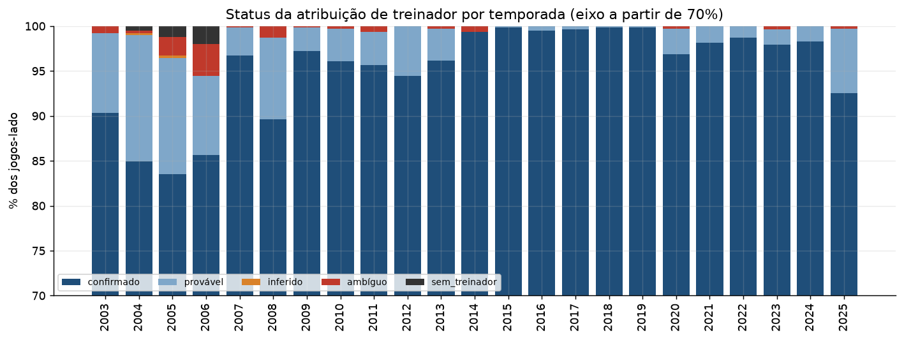
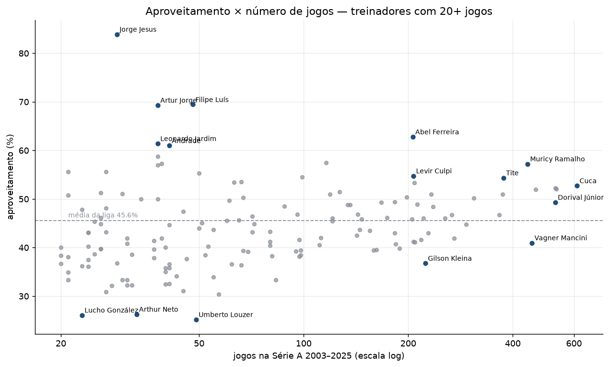
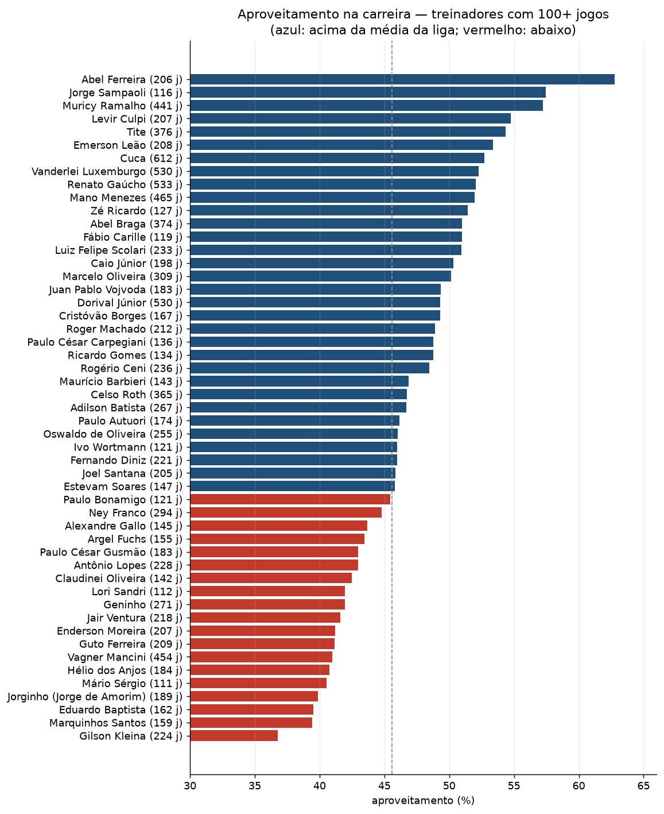
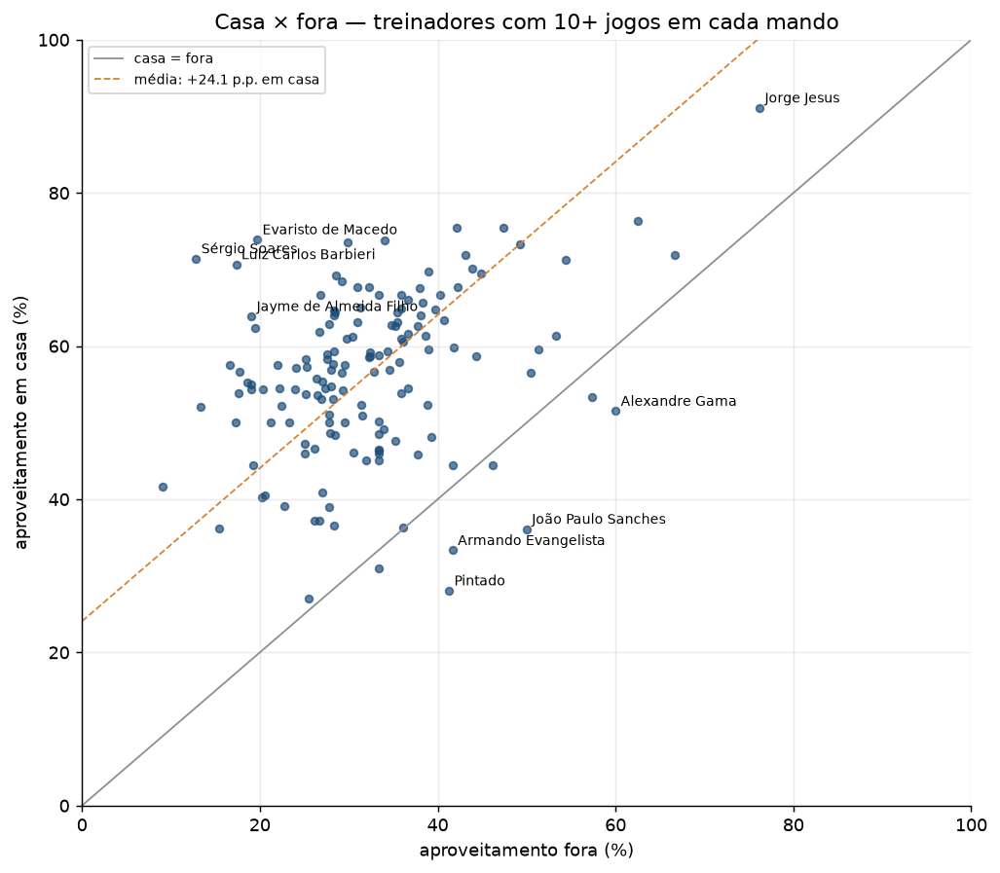
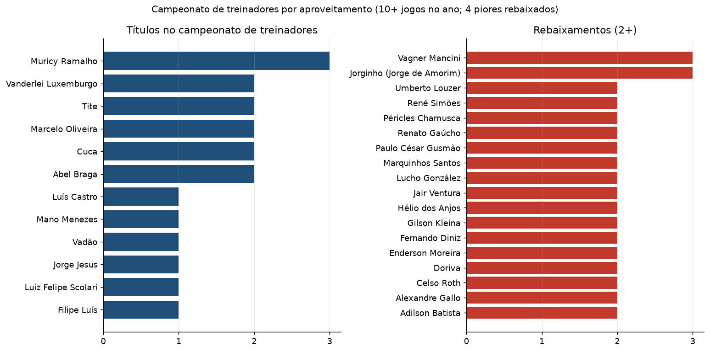

# 03 — Série A head coaches (2003–2025)

[Português](README.md)

## The question

Who were the best and worst head coaches of the Série A round-robin era — by
points percentage, wins, losses, attack, defence, by club, by season, and home
versus away?

Answering that first needs a reliable **coach × match** base: every match
credited to whoever was actually on the bench, including when a club changed
coach mid-season. The most widely used public base (the same one behind
analyses 01 and 02) has `tecnico_mandante` / `tecnico_visitante` **empty before
2014**. So this analysis has two parts: **build and validate the base**, and
only then **rank**.

## Scope

Série A, **2003 to 2025** (23 editions). 9,165 matches — 9,166 scheduled minus
Chapecoense × Atlético-MG in 2016, never played after the plane crash — and
**18,330 team-matches** (one row per club per match). It includes 2025, which is
not in the base used by analyses 01 and 02.

## How the base was built

Four sources, each with a role:

| Source | Provides | Coverage |
|---|---|---|
| **Transfermarkt** — match report of every game | matches, score and each side's coach, with a unique person ID | 2003–2025 · 18,208 sides named |
| **O Gol (zerozero)** — each coach's "matches managed" page | which games each coach managed, home or away | 2003–2025 · 17,413 sides |
| **CBF** (via [adaoduque/Brasileirao_Dataset](https://github.com/adaoduque/Brasileirao_Dataset)) | coach on the official match sheet, score | coach 2014–2024; score 2003–2024 |
| **Wikipedia** (en 2003–04; pt 2008–25) | 510 coaching changes with dates; results matrix | external validation |

Each side gets a **status**: `confirmado` (two or more match-level sources name
the same person), `provável` (one source, nothing against it), `inferido`,
`ambíguo` or `sem_treinador`. Main rules:

- **Whoever was on the bench gets the match** — no "coach of the season". A
  caretaker who took over between two coaches counts.
- **A brief absence goes back to the head coach.** Up to 2 matches of another
  name *between* matches of the same coach in the same season (suspension,
  illness) are credited to the head coach — a rule inspired by ge's coaching
  turnover survey. The original name is kept in `atribuicao_original` (80 sides).
- **Source conflicts**, in order: O Gol + CBF against Transfermarkt → date of the
  change on Wikipedia → same coach before and after → otherwise `ambíguo`.
- **Chronological impossibility:** a coach cannot be at one club while having
  confirmed matches at another.

A documented pitfall: O Gol's **match pages** served to a scraper carry line-ups
from other games and scores that almost never match the CBF — they were
discarded. The same site's per-coach lists agree 97.9% with the CBF,
independently of Transfermarkt, and were used.

Details and reproduction in [coleta/README.md](coleta/README.md).

## Data quality

- **94.9%** of team-matches confirmed by 2+ sources; 99.3% confirmed or probable.
- **127 matches** still have at least one uncertain side, concentrated in
  2005–2006 (Ponte Preta 2006 has 11 matches with no coach in any source).
- **Independent** validation: of the 510 changes listed on Wikipedia, **498**
  appear in the rebuilt sequence without Wikipedia being used for attribution.
- Coaching changes per season (excluding caretakers of up to 3 games) match the
  figures published by ge: 2003 39 vs 40; 2010 33 vs 31; 2015 30 vs 32; 2023 25 vs 25.
- Scores: 100% equal to the CBF (8,785 matches) and 99.75% equal to Wikipedia.
- Sensitivity: re-running the rankings with only confirmed/probable sides leaves
  the points-percentage Top 20 unchanged and swaps one name in the Bottom 20.

Full audit (14 consistency tests, all passing) in [coleta/auditoria.md](coleta/auditoria.md).

## Results

Fixed filters: **20, 50 or 100 matches** for careers, **5 matches** per season,
**10 matches** at home and away, **20 matches** at a club. Exact ties share a
position; the secondary criterion is always "more matches". League average:
45.6% points percentage (draws hand out 2 points, not 3).

### Points percentage vs career length

With 20+ matches the leaders are Jorge Jesus (83.9% in 29 matches), Filipe Luís
(69.4%, 48) and Artur Jorge (69.3%, 38). Among long careers the picture changes:

| 100+ matches | M | Pts % | | 100+ matches | M | Pts % |
|---|---:|---:|---|---|---:|---:|
| Abel Ferreira | 206 | 62.8% | | Gilson Kleina | 224 | 36.8% |
| Jorge Sampaoli | 116 | 57.5% | | Marquinhos Santos | 159 | 39.4% |
| Muricy Ramalho | 441 | 57.2% | | Eduardo Baptista | 162 | 39.5% |
| Levir Culpi | 207 | 54.8% | | Jorginho (J. de Amorim) | 189 | 39.9% |
| Tite | 376 | 54.3% | | Mário Sérgio | 111 | 40.5% |

**Wins:** volume and frequency are different things. Cuca has the most wins (266
in 612 matches), followed by Renato Gaúcho and Luxemburgo (229 each), all at
about 43% wins per game. Only five coaches are in both the top 20 for total wins
and the top 20 for win rate: Abel Ferreira, Muricy, Tite, Levir Culpi and
Emerson Leão.

**Losses:** Vagner Mancini has the most losses (188 in 454 matches) — most
losses is not the same as worst coach: eight of the ten leaders in total losses
are above the league-average points percentage.

**Attack and defence:** per game, Jorge Jesus (2.45 goals) and Filipe Luís (0.71
conceded) lead with 20+ matches; with 100+, Emerson Leão (1.66) and Abel
Ferreira (0.89).

**Best single-season jobs** (19+ matches): Jorge Jesus/Flamengo 2019 (83.9%),
Felipão/Palmeiras 2018 (81.8%), Cuca/Atlético-MG 2021 (73.7%).

### Home vs away

Among the 146 coaches with 10+ matches at home and away, the home points
percentage is on average **24.1 percentage points** higher — the same
league-level effect as in analysis 01, seen from the coach's side.

### A league of coaches

Each season becomes a "league" of coaches ranked by points percentage (only
those with 10+ matches that year, across all clubs they managed): 1st is the
champion and the bottom 4 are relegated.

Muricy Ramalho has the most titles (2006, 2007, 2008); Luxemburgo, Tite, Cuca,
Abel Braga and Marcelo Oliveira have 2 each. Vagner Mancini and Jorginho (Jorge
de Amorim) were "relegated" 3 times. Renato Gaúcho finished in the top 4 six
times without a title and was relegated twice (2008 and 2009).

## Caveats

- **Points percentage measures the job and the squad together.** Bigger-budget
  clubs concentrate the best numbers (Flamengo has 10 of 18 coaches with 20+
  matches above 55%). The rankings do not isolate the coach's merit.
- **Short samples:** with a 20-match minimum, short standout spells dominate the
  extremes — hence the 50- and 100-match cuts.
- **2005–2007** have no Wikipedia change table; there, validation is
  Transfermarkt vs O Gol only.
- **Season edges** (e.g. Renato resting at the end of 2016, 2017 and 2019) stay
  with whoever was on the bench; the absence rule only applies between matches
  of the same coach.
- Data derived from Transfermarkt and O Gol pages, published here for study
  purposes with sources credited.

## Files

- `apresentacao/treinadores_serie_a_2003_2025.pdf` — slide deck with the results (50 slides, in Portuguese).
- `run.py` — builds the tables and figures from `data/external/treinadores/`
  (no network access).
- `outputs/tables/` — `compilado_treinadores` (all 353 coaches, with titles and
  relegations), `rankings_carreira` (top/bottom 20 per metric at 20, 50 and 100
  matches), `extremos_por_temporada`, `por_clube_min20`,
  `por_clube_min50_com_recuo` (31 clubs with 5+ seasons; the minimum steps down
  to 40/30/20/10 when fewer than 2 coaches qualify), `trabalhos_por_temporada`,
  `historico_mandante`, `historico_visitante`, `casa_x_fora`,
  `campeonato_treinadores_por_ano`, `campeonato_resumo_por_ano`.
- `outputs/figures/` — the 5 figures above.
- `coleta/` — scripts that build the base (scraping, matching, validation).
- `src/futebrasil/treinadores.py` — base loading, aggregation, tie-aware
  rankings, streaks and the league of coaches.
