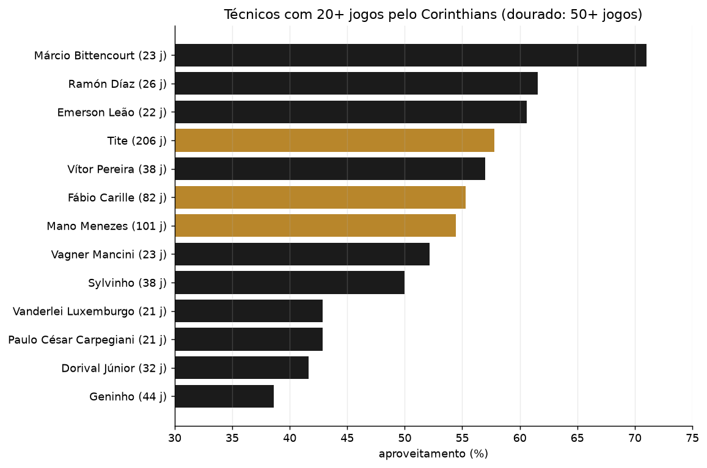
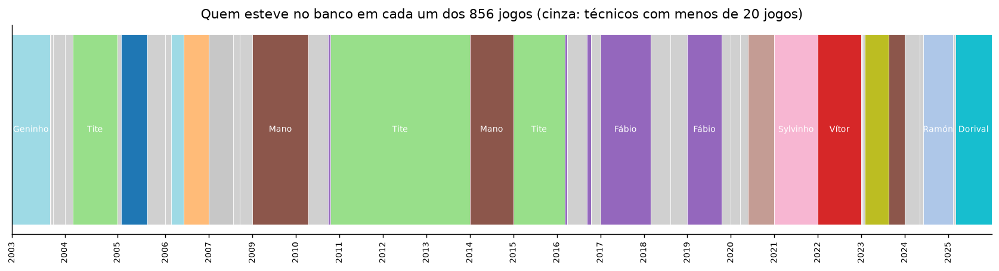
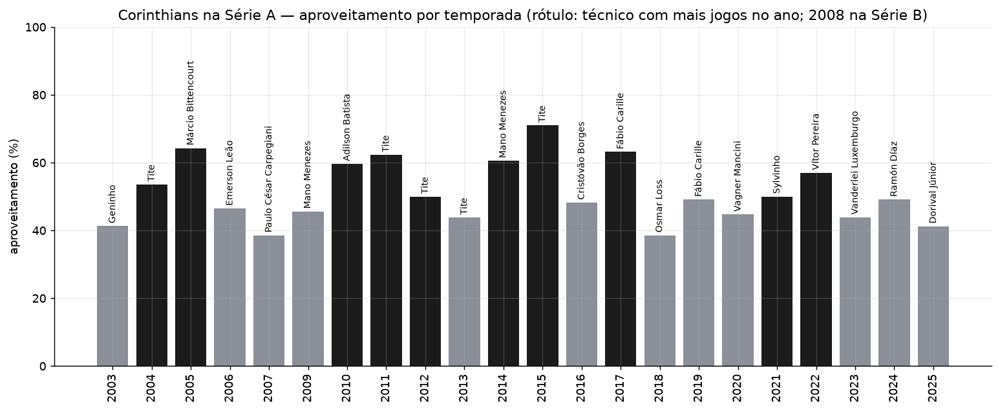

# 04 — Treinadores do Corinthians na Série A (2003–2025)

[English](README.en.md)

## A pergunta

Entre todos os técnicos que dirigiram o Corinthians na Série A desde 2003, quem
teve mais e menos aproveitamento, vitórias, derrotas, gols, saldo e as melhores
e piores sequências? E, olhando pelo calendário, quais foram as melhores e
piores temporadas do clube?

## Recorte e base

Recorte da base treinador × partida da [análise 03](../03-treinadores-da-serie-a/)
(`data/external/treinadores/`): **856 jogos** do Corinthians em **22
temporadas** (2008 o clube estava na Série B), **34 técnicos** e **45
passagens** (sequências contínuas de um mesmo técnico no comando).

Duas visões:

- **Técnico** — em três recortes: completa (todos os 34, inclusive interinos de
  1 jogo), **20+ jogos** pelo clube (13 técnicos) e **50+ jogos** (3: Tite, Mano
  Menezes e Fábio Carille).
- **Temporada** — os 22 anos do clube na Série A.

Para cada recorte, uma "ficha" com o **mais** e o **menos** de cada métrica
(valores brutos: em gols sofridos e em série de derrotas, "mais" é o pior),
mostrando todos os empatados e o número de jogos de cada um.

**Sequências:** maior série de vitórias, de derrotas, invicta (sem derrota) e
sem vencer, e o melhor e o pior aproveitamento em 10 jogos seguidos. Para
técnico, a série conta só jogos seguidos dentro de uma mesma passagem; para
temporada, todos os jogos do ano.

## Visão técnico

| | Completa (34) | 20+ jogos (13) | 50+ jogos (3) |
|---|---|---|---|
| Maior aproveitamento | Fernando Lázaro, Jairo Leal — 100% (1 jogo) | Márcio Bittencourt — 71,0% (23 j) | Tite — 57,8% (206 j) |
| Menor aproveitamento | Júnior, Cuca, Danilo — 0% (1–2 jogos) | Geninho — 38,6% (44 j) | Mano Menezes — 54,5% (101 j) |
| Mais jogos / vitórias | Tite — 206 / 98 | Tite | Tite |
| Mais gols por jogo | Bittencourt — 2,22 | Bittencourt — 2,22 | Mano — 1,37 |
| Menos gols sofridos por jogo | Tite — 0,83 | Tite — 0,83 | Tite — 0,83 |
| Maior saldo | Tite — +101 | Tite — +101 | Tite — +101 |
| Menor saldo | Oswaldo de Oliveira — −14 | Carpegiani — −5 | Mano — +22 |
| Maior série de vitórias | Ramón Díaz — 9 | Ramón Díaz — 9 | Tite — 7 |
| Maior série de derrotas | Geninho — 6 | Geninho — 6 | Tite, Mano — 3 |
| Maior série invicta | Fábio Carille — 19 | Fábio Carille — 19 | Fábio Carille — 19 |
| Maior série sem vencer | Carpegiani — 10 | Carpegiani — 10 | Fábio Carille — 8 |
| Melhor / pior trecho de 10 jogos | Tite, Carille, Ramón Díaz — 93,3% / Geninho — 13,3% | idem | Tite, Carille — 93,3% / Tite — 23,3% |

Fichas completas (todas as métricas, mais e menos) em
`outputs/tables/ficha_tecnicos_{todos,min20,min50}.csv`.

Leitura: Tite domina os totais e tem a defesa mais sólida por jogo; o melhor
índice com 20+ jogos é o de Márcio Bittencourt no título de 2005, que também tem
o ataque mais forte e a defesa mais vazada por jogo desse grupo. As melhores
séries são de Carille (19 jogos sem perder, o início de 2017) e Ramón Díaz (9
vitórias seguidas no fim de 2024).

## Visão temporada

| Métrica | Mais | Menos |
|---|---|---|
| Aproveitamento | 2015 — 71,1% | 2007 e 2018 — 38,6% |
| Vitórias | 2005 (42 j) e 2015 — 24 | 2007 — 10 |
| Derrotas | 2003 (46 j) — 19 | 2015 — 5 |
| Gols feitos (por jogo) | 2005 — 87 (2,07) | 2013 — 27 (0,71) |
| Gols sofridos (por jogo) | 2003 — 63 · por jogo, 2009 — 1,42 | 2013 — 22 (0,58) |
| Saldo | 2015 — +40 | 2007 — −10 |
| Maior série de vitórias | 2024 — 9 | 2023 — 1 |
| Maior série de derrotas | 2006 — 6 | 14 temporadas — 2 |
| Maior série invicta | 2017 — 19 | 2018 — 3 |
| Maior série sem vencer | 2007 — 10 | 6 temporadas — 3 |
| Trecho de 10 jogos | 2011, 2017, 2024 — 93,3% | 2006 — 13,3% |

2003 e 2004 tiveram 46 jogos e 2005, 42 (as demais, 38): nos totais, compare
também os valores por jogo em `outputs/tables/temporadas.csv`.

## Ressalvas

- Herda as ressalvas da base da análise 03 (status de atribuição, regra de
  ausência pontual). Nos jogos do Corinthians, 843 dos 856 técnicos estão
  confirmados por duas ou mais fontes e 13 são prováveis (uma fonte, sem
  contradição); nenhum é ambíguo.
- Aproveitamento mede o trabalho do técnico e o elenco juntos.
- Interinos de 1 ou 2 jogos dominam os extremos da visão completa — por isso os
  cortes de 20 e 50 jogos.

## Arquivos

- `apresentacao/corinthians_treinadores_2003_2025.pdf` — apresentação com os resultados (18 slides).
- `run.py` — gera tudo a partir de `data/external/treinadores/`.
- `outputs/tables/` — `tecnicos` (34 técnicos com todas as métricas e séries),
  `ficha_tecnicos_todos`, `ficha_tecnicos_min20`, `ficha_tecnicos_min50`,
  `temporadas`, `ficha_temporadas`, `jogos_corinthians` (os 856 jogos, com
  status e fonte de cada atribuição).
- `outputs/figures/` — as 3 figuras acima.
